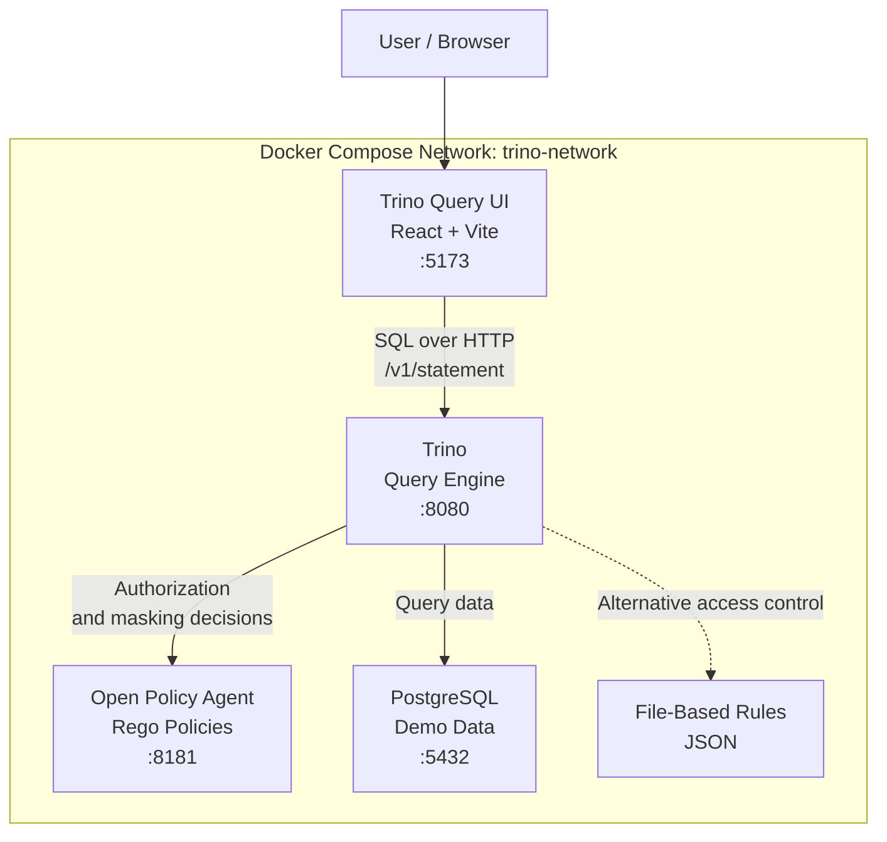

# Trino Access Control: File-Based vs. OPA

A hands-on demonstration of fine-grained access control in [Trino](https://trino.io/), comparing **File-Based Access Control** with **Open Policy Agent (OPA)**.

This project demonstrates how to manage user permissions, restrict access to catalogs, and implement column-level data masking at query time (*mask-on-read*). It uses Docker Compose to run Trino, OPA, PostgreSQL, and the Trino Query UI in a local development environment.

## Table of Contents

- [Overview](#overview)
- [Architecture](#architecture)
- [Project Structure](#project-structure)
- [Prerequisites](#prerequisites)
- [Quick Start](#quick-start)
- [Configuring Access Control](#configuring-access-control)
  - [File-Based Access Control](#1-file-based-access-control)
  - [OPA Access Control](#2-opa-access-control)
- [Configuring the Trino Query UI](#configuring-the-trino-query-ui)
- [Testing Access Control](#testing-access-control)
- [Useful Commands](#useful-commands)
- [References](#references)

## Overview

Trino provides a pluggable access control system that allows administrators to define which users can access catalogs, schemas, tables, and columns.

This project compares two approaches:

| Feature | File-Based | OPA |
|---|---|---|
| Policy definition | JSON configuration | Rego policies |
| Access control | Rule-based permissions | Policy-driven authorization |
| Column masking | Column-specific rules | Dynamic, policy-based expressions |
| Policy flexibility | Structured configuration | Flexible conditions and custom logic |
| Policy management | Configuration files | Centralized policy evaluation |

### Demonstrated Use Cases

- Restricting access to specific catalogs and schemas.
- Applying different permissions to different users.
- Masking sensitive data when queries are executed.
- Comparing static configuration rules with dynamic authorization policies.
- Using the same Trino environment to test both access control approaches.

**The main goal is to demonstrate how OPA enables more flexible access control policies, including conditional column masking, compared with the file-based approach.**

## Architecture

The environment runs as a set of Docker Compose services connected through a shared bridge network.



### Services

| Service | Port | Responsibility |
|---|---:|---|
| `trino` | `8080` | Executes SQL queries and enforces access control. |
| `trino-query-ui` | `5173` | Provides a browser-based SQL interface. |
| `opa` | `8181` | Evaluates Rego policies for authorization and column masking. |
| `postgres` | `5432` | Provides sample relational data for testing. |

The File-Based and OPA implementations are alternative access control configurations for Trino. Select the implementation by changing the configuration mounted at `/etc/trino/access-control.properties`.

## Project Structure

```text
trino-access-control-/
├── docs/
│   └──                         # Project documentation
├── etc/
│   ├── access-control-opa.properties
│   ├── config.properties
│   ├── rules.json
│   └── catalog/
│       └── postgresql.properties
├── opa/
│   └── trino.rego              # OPA authorization and masking policies
├── postgres/
│   ├── Dockerfile
│   └── init/                   # Demo database initialization
├── docker-compose-trino.yml
├── Makefile
└── .gitignore

# Cloned separately:
trino-query-ui/
├── Dockerfile.dev
├── vite.config.ts
└── src/
    └── AsyncTrinoClient.tsx
```

The exact contents of the `docs/` and `postgres/init/` directories may evolve as the project develops.

## Prerequisites

Before starting, ensure the following tools are installed:

- **Docker Engine or Docker Desktop** — to run the containers.
- **Docker Compose** — to orchestrate the services. Docker Desktop includes Docker Compose.
- **Git** — to clone the repositories.

Verify your installation:

```bash
docker --version
docker compose version
git --version
```

You do not need to install Trino, OPA, PostgreSQL, or Node.js directly on your host if you run the complete environment through Docker Compose.

## Quick Start

### 1. Clone the repository

```bash
git clone https://github.com/JJader/trino-access-control-.git
cd trino-access-control-
```

### 2. Clone the Trino Query UI

The [Trino Query UI](https://github.com/trinodb/trino-query-ui) is an open-source React and TypeScript application that provides a web-based SQL editor for Trino. It supports catalog browsing, SQL execution, result inspection, and query monitoring.

Clone it into the project root because the Docker Compose configuration expects it at `./trino-query-ui`.

```bash
git clone https://github.com/trinodb/trino-query-ui.git
```

Your directory structure should now include:

```text
trino-access-control-/
├── docker-compose-trino.yml
├── etc/
├── opa/
├── postgres/
└── trino-query-ui/
```

### 3. Choose the access control implementation

Before starting the environment, configure the access control properties mounted into Trino.

The provided Docker Compose file uses the OPA configuration by default:

```yaml
volumes:
  - ./etc/access-control-opa.properties:/etc/trino/access-control.properties
```

To use File-Based Access Control instead, replace the source file with your file-based configuration:

```yaml
volumes:
  - ./etc/access-control-file.properties:/etc/trino/access-control.properties
```

Make sure the referenced file exists and contains the appropriate configuration. The examples below explain both approaches.

## Configuring the Trino Query UI

The Trino Query UI is cloned separately from the main repository. The following steps configure it to run inside Docker and communicate with Trino through the internal Docker network.

### 1. Create the development Dockerfile

Inside `trino-query-ui/`, create `Dockerfile.dev`:

```dockerfile
FROM node:20-alpine

WORKDIR /app

COPY package.json package-lock.json ./
RUN npm install

COPY . .

EXPOSE 5173

CMD ["npm", "run", "dev", "--", "--host", "0.0.0.0"]
```

This Dockerfile installs the Node.js dependencies and starts the Vite development server, listening on all container interfaces so it can be reached from the host.

**Node.js version note:** the upstream Trino Query UI documentation currently specifies Node.js 24 or newer. If the current checkout requires that version, change the first line to `FROM node:24-alpine`.

### 2. Configure the Vite proxy

Edit `trino-query-ui/vite.config.ts`.

Inside the existing `defineConfig` configuration, add or update the `server.proxy` section from `http://localhost:8080` to `http://trino:8080`:

```typescript
server: {
  proxy: {
    '/v1': {
      target: 'http://trino:8080',
      changeOrigin: true,
      secure: false,
    },
  },
},
```

Keep the existing Vite plugins and other configuration options.

The proxy forwards requests to `/v1` to the Trino service. Since both containers belong to `trino-network`, the hostname `trino` resolves to the Trino container.

### 3. Configure the Trino user

Edit `trino-query-ui/src/AsyncTrinoClient.tsx`.

Find the `X-Trino-User` header and change its value from `system` to the user you want to test.

For example:

```typescript
'X-Trino-User': 'admin',
```

Or:

```typescript
'X-Trino-User': 'blocked_user',
```

Use the appropriate syntax for the existing request headers in the file.

This setting is particularly important when testing access control: Trino uses the supplied identity when evaluating the user's permissions.

**Security note:** `X-Trino-User` identifies the SQL user; it does not authenticate that user. This configuration is intended for a local demonstration, not as a production authentication mechanism.

### 4. Start the environment

From the project root, run:

```bash
docker compose -f docker-compose-trino.yml up --build -d
```

Check the running services:

```bash
docker compose -f docker-compose-trino.yml ps
```

Open the query interface:

- **Trino Query UI:** http://localhost:5173
- **Trino Web UI:** http://localhost:8080

The Trino Web UI and Query UI serve different purposes: the first provides Trino's built-in interface, while the second provides the SQL editor used for this demonstration.

## Configuring Access Control

### 1. File-Based Access Control

File-Based Access Control defines permissions through a JSON rules file. It is useful when access policies can be expressed as structured rules without requiring a separate policy engine.

Create or configure `etc/access-control-file.properties`:

```properties
access-control.name=file
security.config-file=/etc/trino/rules.json
```

The Docker Compose configuration must mount both the access control properties and the rules file:

```yaml
volumes:
  - ./etc/access-control-file.properties:/etc/trino/access-control.properties
  - ./etc/config.properties:/etc/trino/config.properties
  - ./etc/rules.json:/etc/trino/rules.json
```

Edit `etc/rules.json` to define the permissions required by your demonstration. The file-based access control implementation supports catalog, schema, table, and column-level rules, subject to the available rule properties.

For additional details, see the [Trino File-Based Access Control documentation](https://trino.io/docs/current/security/file-system-access-control.html).

### 2. OPA Access Control

[Open Policy Agent](https://www.openpolicyagent.org/) is a general-purpose policy engine that evaluates policies written in Rego.

In this project, OPA evaluates Trino authorization requests and can return column-masking expressions based on the configured policies.

Configure `etc/access-control-opa.properties`:

```properties
access-control.name=opa
opa.policy.uri=http://opa:8181/v1/data/trino/allow
opa.policy.column-masking-uri=http://opa:8181/v1/data/trino/columnMask
```

The hostname `opa` refers to the OPA service on the shared Docker Compose network. Use the container service name rather than `localhost` for communication between containers.

The Rego policies are located in:

```text
opa/trino.rego
```

The policy file defines the authorization and column-masking logic. For example, a policy can distinguish between users, deny access to a specific catalog, or generate masking expressions for columns matching a naming convention.

Restart the services after changing the configuration:

```bash
docker compose -f docker-compose-trino.yml up --build -d
```

To inspect OPA logs:

```bash
docker compose -f docker-compose-trino.yml logs -f opa
```

For additional details, see the [Trino OPA Access Control documentation](https://trino.io/docs/current/security/opa-access-control.html).


## Testing Access Control

Once all services are running, use the query interface to validate the policies.

### Suggested test scenarios

| Scenario | Expected behavior |
|---|---|
| Authorized user queries an allowed table | The query succeeds, provided the user has the required privileges. |
| Restricted user queries a denied catalog | The query is rejected according to the configured policy. |
| Restricted user queries a table with masked columns | The query returns transformed values for columns covered by the masking policy. |
| User queries a table without masked columns | Values remain unchanged unless another policy applies. |
| User adds a `WHERE` condition on a masked column | Access and filtering behavior follow Trino's column-masking semantics and the configured policy. |

Use actual catalogs, tables, users, and rules from the running environment when validating each scenario.

### Example SQL queries

List available catalogs:

```sql
SHOW CATALOGS;
```

Inspect schemas:

```sql
SHOW SCHEMAS FROM postgresql;
```

Inspect tables:

```sql
SHOW TABLES FROM postgresql.public;
```

Query the demo users table:

```sql
SELECT *
FROM postgresql.public.users
LIMIT 10;
```

The PostgreSQL catalog is provided by the demo environment. If your catalog or table names differ, replace them with the objects available in your setup.

### Compare File-Based and OPA

To compare the two approaches:

1. Run the environment using File-Based Access Control.
2. Execute the same SQL queries with the same test identities.
3. Record which operations are allowed or denied and which columns are masked.
4. Switch the mounted access control properties to the OPA configuration.
5. Restart Trino and repeat the same tests.

This allows you to compare the behavior of both implementations under equivalent conditions.

## Useful Commands

Start all services:

```bash
docker compose -f docker-compose-trino.yml up --build -d
```

View service status:

```bash
docker compose -f docker-compose-trino.yml ps
```

Follow Trino logs:

```bash
docker compose -f docker-compose-trino.yml logs -f trino
```

Follow OPA logs:

```bash
docker compose -f docker-compose-trino.yml logs -f opa
```

Follow PostgreSQL logs:

```bash
docker compose -f docker-compose-trino.yml logs -f postgres
```

Stop the environment:

```bash
docker compose -f docker-compose-trino.yml down
```

Stop the environment and remove its containers and networks:

```bash
docker compose -f docker-compose-trino.yml down
```

## References

- [Trino Documentation](https://trino.io/docs/current/)
- [Trino File-Based Access Control](https://trino.io/docs/current/security/file-system-access-control.html)
- [Trino OPA Access Control](https://trino.io/docs/current/security/opa-access-control.html)
- [Open Policy Agent Documentation](https://www.openpolicyagent.org/docs/latest/)
- [Trino Query UI Repository](https://github.com/trinodb/trino-query-ui)

## Disclaimer

This repository is intended for educational purposes and local demonstrations of Trino access control. The configuration is not intended for production use without appropriate authentication, authorization, network security, and operational hardening.
